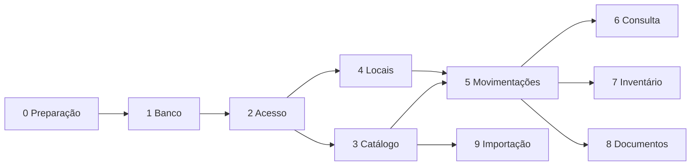

# Roteiro de construção

O sistema é construído em dez etapas. Cada etapa depende das anteriores e entrega algo que pode ser testado sozinho.

As etapas 3 e 4 podem andar ao mesmo tempo, assim como 6, 7, 8 e 9.

## Trabalho por frente

A equipe se divide em três frentes ([[decisions#ADR-13 Divisão do trabalho por frente|ADR-13]]). Dentro de cada etapa, as tarefas estão separadas por frente. As regras do sistema ficam no backend ([[decisions#ADR-15 Regras no backend e banco simples|ADR-15]]) e o banco é simples. As telas não falam com o banco: chamam as funções que o backend escreve em `backend/src/` ([[decisions#ADR-14 Telas acessam os dados pelas funções de lib|ADR-14]]).

### A fila de cada frente

| Ordem | Banco de dados | Backend | Front-end |
|---|---|---|---|
| 1 | Etapa 0: ambiente. Leitura da especificação ([[banco-de-dados]]) | Etapa 0: repositório, Supabase de desenvolvimento e ambiente. Especificação do banco | Etapa 0: ambiente. Identidade visual e protótipo das telas |
| 2 | Etapa 1: migração inicial, dados de teste e testes do que o banco recusa | Etapa 1: conexão do servidor com o banco e conferência de perfil (T1.6) | Protótipo das telas |
| 3 | Correções apontadas na validação | Etapa 1: validar o banco entregue (T1.5). Etapa 2: sessão, proteção de rotas e usuários | Etapa 2: telas de login, "aguardando liberação", usuários e menu |
| 4 | Migrações novas, quando uma etapa pedir uma mudança no banco | Funções das etapas 3 e 4 | Telas das etapas 3 e 4 |
| 5 | | Funções da etapa 5, depois 6, 7, 8 e 9 | Telas da etapa 5, depois 6, 7, 8 e 9 |

O backend trabalha uma etapa à frente do front-end: quando o front-end começa as telas de uma etapa, as funções dela já existem.

### O que uma frente entrega para a outra

| De | Para | Entrega |
|---|---|---|
| Backend | Banco de dados | A especificação e o contrato em [[banco-de-dados]] |
| Banco de dados | Backend | O banco montado no Supabase de desenvolvimento, com os dados de teste e o resultado dos testes do que o banco recusa |
| Backend | Front-end | As funções de cada etapa em `backend/src/`, com os tipos dos dados |
| Front-end | Backend | O pedido de uma função que falte, antes de a tela ser construída |

Uma mudança que atravessa a fronteira (o banco muda um nome do contrato, a tela precisa de um dado que não existe) é combinada entre os líderes das frentes antes de ser feita.

## Quadro

| Etapa | Entrega | Situação |
|---|---|---|
| [[etapa-0-preparacao\|Etapa 0 — Preparação]] | Deixar todo mundo com o projeto rodando no próprio computador, no mesmo repositório e no mesmo banco de desenvolvimento. | Em execução |
| [[etapa-1-banco\|Etapa 1 — Banco de dados]] | Criar toda a estrutura do banco a partir da especificação em `banco-de-dados`. | Em execução |
| [[etapa-2-acesso\|Etapa 2 — Acesso]] | Login, perfis e liberação de usuários. | Em execução |
| [[etapa-3-catalogo\|Etapa 3 — Catálogo]] | Cadastro de categorias, famílias e variantes. | Em execução |
| [[etapa-4-locais\|Etapa 4 — Locais]] | Cadastro da árvore de endereços. | Em execução |
| [[etapa-5-movimentacoes\|Etapa 5 — Movimentações]] | Registrar entrada, saída e transferência, e mostrar o histórico. | Em execução |
| [[etapa-6-consulta\|Etapa 6 — Consulta]] | Responder rápido, no celular, "onde está?" e "o que há aqui?". | Em execução |
| [[etapa-7-inventario\|Etapa 7 — Inventário]] | Contar um local e corrigir as diferenças com registro. | A fazer |
| [[etapa-8-documentos\|Etapa 8 — Documentos de saída]] | Receber pedidos de outro sistema e dar baixa por QR code. | Em execução (código pronto; falta validar com banco real, ver [[plano-de-testes]]) |
| [[etapa-9-importacao\|Etapa 9 — Importação]] | Carregar o catálogo inicial a partir de planilha. | A fazer |

Situações possíveis: **A fazer**, **Em execução**, **Concluída**. Atualize esta tabela quando a etapa mudar.

## Como usar

1. Escolha uma tarefa da etapa em execução e coloque seu nome em "Responsável".
2. Trabalhe em uma branch própria, como explica o guia `05-guides/02-fluxo-git.md`.
3. Marque a caixa da tarefa quando o pull request for aceito.
4. A etapa só é concluída quando todos os itens de "Pronto quando" estiverem marcados.
