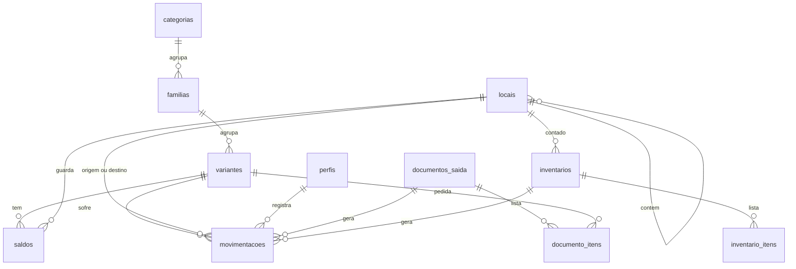

# Banco de dados

Este documento é a especificação do banco, escrita para a frente de banco de dados. O banco deste projeto é simples de propósito: **guarda os dados e recusa valores inválidos**. As regras de operação (movimentar estoque, dar baixa, fazer inventário, conferir permissões) ficam no backend e estão em [[backend]]. A decisão está em [[decisions#ADR-15 Regras no backend e banco simples|ADR-15]].

## O que a frente de banco entrega

1. Uma migração em `backend/supabase/migrations/` com os tipos, as tabelas e as restrições deste documento. Os índices são opcionais (ver "Índices").
2. A segurança por linha (RLS) ativada em todas as tabelas, **sem nenhuma política** (ver "Acesso").
3. Dados de teste em `backend/supabase/seed.sql` (ver "Dados de teste").
4. Os testes da seção "O que o banco precisa recusar", feitos no Supabase de desenvolvimento.

**O que não é trabalho do banco**: funções, gatilhos, visões e regras por perfil. Se alguma dessas coisas parecer necessária, converse com a frente de backend antes de criar.

## Visão das tabelas



## Tabelas

| Tabela | Guarda | Observações |
|---|---|---|
| `perfis` | Nome, e-mail e perfil de cada usuário | Uma linha por usuário do login |
| `categorias` | Tipos de produto | `atributos` lista as características da categoria; `limiar_padrao` é o estoque mínimo herdado |
| `familias` | Modelos de produto | Pertence a uma categoria |
| `variantes` | Itens contáveis | `codigo` único; `atributos` com os valores; `estoque_minimo` vazio significa "herda da categoria" |
| `locais` | Endereços físicos em árvore | `pai_id` aponta para o local que o contém; `codigo` único; `capacidade` é opcional |
| `movimentacoes` | Histórico de tudo que entrou, saiu ou mudou de lugar | Só recebe linhas novas |
| `saldos` | Quantidade de cada variante em cada local | |
| `inventarios` | Contagens de um local | |
| `inventario_itens` | Itens de uma contagem | Quantidade do sistema e quantidade contada |
| `documentos_saida` | Pedidos vindos de outro sistema | `protocolo` único |
| `documento_itens` | Itens de um documento | Variante e quantidade pedida |

## Como os atributos funcionam

A categoria diz **quais** atributos existem, em uma coluna do tipo JSON:

```json
[
  {"chave": "potencia_w", "rotulo": "Potência (W)", "tipo": "numero"},
  {"chave": "temperatura_cor_k", "rotulo": "Temperatura de cor (K)", "tipo": "numero"},
  {"chave": "tensao", "rotulo": "Tensão", "tipo": "texto"}
]
```

A variante guarda **os valores**, também em JSON:

```json
{"potencia_w": 100, "temperatura_cor_k": 5000, "tensao": "bivolt"}
```

Assim uma categoria nova, com características próprias, é criada pela tela, sem alterar a estrutura do banco. O banco não confere o conteúdo desses campos: só precisa aceitar JSON.

## Contrato: nomes e tipos

O backend é escrito contando com os nomes e tipos desta seção. A frente de banco decide **como** escrever o SQL, mas os nomes de tabelas e colunas precisam ser exatamente estes. Se algum precisar mudar, combine com a frente de backend e atualize este documento antes.

Em todas as tabelas, `id` é gerado pelo banco e `criado_em` recebe a data e hora do momento da gravação.

### Tipos com valores fixos

| Tipo | Valores |
|---|---|
| `cargo` | `pendente`, `estoquista`, `gerente`, `gerente_estoque`, `admin` |
| `tipo_movimentacao` | `entrada`, `saida`, `transferencia`, `ajuste` |
| `status_inventario` | `aberto`, `concluido`, `cancelado` |
| `status_documento` | `pendente`, `baixado`, `cancelado` |

### Colunas de cada tabela

**`perfis`**

| Coluna | Tipo | Obrigatória | Observação |
|---|---|---|---|
| `id` | uuid | sim | O mesmo `id` do usuário no login do Supabase (`auth.users`). Apagar o usuário apaga o perfil |
| `nome` | texto | sim | |
| `email` | texto | sim | |
| `cargo` | `cargo` | sim | Padrão `pendente`. O backend sempre informa o cargo ao criar um acesso pelo administrador |
| `criado_em` | data e hora | sim | |

**`categorias`**

| Coluna | Tipo | Obrigatória | Observação |
|---|---|---|---|
| `id` | uuid | sim | |
| `nome` | texto | sim | Único |
| `limiar_padrao` | inteiro | sim | Padrão 0. Não pode ser negativo |
| `atributos` | JSON | sim | Padrão: lista vazia |
| `criado_em` | data e hora | sim | |

**`familias`**

| Coluna | Tipo | Obrigatória | Observação |
|---|---|---|---|
| `id` | uuid | sim | |
| `categoria_id` | uuid | sim | Aponta para `categorias` |
| `nome` | texto | sim | Único |
| `descricao` | texto | não | |
| `imagem_url` | texto | não | |
| `ativo` | verdadeiro/falso | sim | Padrão verdadeiro |
| `criado_em` | data e hora | sim | |

**`variantes`**

| Coluna | Tipo | Obrigatória | Observação |
|---|---|---|---|
| `id` | uuid | sim | |
| `familia_id` | uuid | sim | Aponta para `familias` |
| `codigo` | texto | sim | Único em todo o sistema |
| `nome` | texto | sim | |
| `atributos` | JSON | sim | Padrão: objeto vazio |
| `preco` | decimal (12,2) | não | Não pode ser negativo |
| `imagem_url` | texto | não | |
| `estoque_minimo` | inteiro | não | Vazio = herda `limiar_padrao` da categoria. Não pode ser negativo |
| `monitorar` | verdadeiro/falso | sim | Padrão verdadeiro |
| `ativo` | verdadeiro/falso | sim | Padrão verdadeiro |
| `criado_em` | data e hora | sim | |
| `atualizado_em` | data e hora | sim | Padrão: momento da gravação |

**`locais`**

| Coluna | Tipo | Obrigatória | Observação |
|---|---|---|---|
| `id` | uuid | sim | |
| `pai_id` | uuid | não | Aponta para `locais`. Vazio = local de primeiro nível. Não pode ser igual ao próprio `id` |
| `nome` | texto | sim | |
| `tipo` | texto | sim | Texto livre: "Galpão", "Setor", "Módulo"... |
| `codigo` | texto | sim | Único |
| `capacidade` | inteiro | não | Se preenchida, maior que zero |
| `ativo` | verdadeiro/falso | sim | Padrão verdadeiro |
| `criado_em` | data e hora | sim | |

**`documentos_saida`**

| Coluna | Tipo | Obrigatória | Observação |
|---|---|---|---|
| `id` | uuid | sim | |
| `protocolo` | texto | sim | Único. É o que o QR code carrega |
| `origem` | texto | sim | Nome do sistema que emitiu o documento |
| `cliente_nome` | texto | não | |
| `solicitante_nome` | texto | não | |
| `status` | `status_documento` | sim | Padrão `pendente` |
| `criado_em` | data e hora | sim | |
| `baixado_por` | uuid | não | Aponta para `perfis` |
| `baixado_em` | data e hora | não | |

**`documento_itens`**

| Coluna | Tipo | Obrigatória | Observação |
|---|---|---|---|
| `id` | uuid | sim | |
| `documento_id` | uuid | sim | Aponta para `documentos_saida`. Apagar o documento apaga os itens |
| `variante_id` | uuid | sim | Aponta para `variantes` |
| `quantidade` | inteiro | sim | Maior que zero |

O par `documento_id` + `variante_id` é único: uma variante aparece no máximo uma vez em cada documento.

**`inventarios`**

| Coluna | Tipo | Obrigatória | Observação |
|---|---|---|---|
| `id` | uuid | sim | |
| `local_id` | uuid | sim | Aponta para `locais` |
| `status` | `status_inventario` | sim | Padrão `aberto` |
| `observacao` | texto | não | |
| `aberto_por` | uuid | sim | Aponta para `perfis` |
| `aberto_em` | data e hora | sim | Padrão: momento da gravação |
| `concluido_por` | uuid | não | Aponta para `perfis` |
| `concluido_em` | data e hora | não | |

**`inventario_itens`**

| Coluna | Tipo | Obrigatória | Observação |
|---|---|---|---|
| `inventario_id` | uuid | sim | Aponta para `inventarios`. Apagar o inventário apaga os itens |
| `variante_id` | uuid | sim | Aponta para `variantes` |
| `quantidade_sistema` | inteiro | sim | Não pode ser negativa |
| `quantidade_contada` | inteiro | não | Vazio = ainda não contado. Não pode ser negativa |

A chave da tabela é o par `inventario_id` + `variante_id`. Não tem coluna `id` nem `criado_em`.

**`movimentacoes`**

| Coluna | Tipo | Obrigatória | Observação |
|---|---|---|---|
| `id` | inteiro grande | sim | Sequencial, gerado pelo banco |
| `variante_id` | uuid | sim | Aponta para `variantes` |
| `tipo` | `tipo_movimentacao` | sim | |
| `quantidade` | inteiro | sim | Sempre maior que zero |
| `local_origem_id` | uuid | não | Aponta para `locais` |
| `local_destino_id` | uuid | não | Aponta para `locais` |
| `documento_id` | uuid | não | Aponta para `documentos_saida` |
| `inventario_id` | uuid | não | Aponta para `inventarios` |
| `justificativa` | texto | não | |
| `usuario_id` | uuid | sim | Aponta para `perfis` |
| `criado_em` | data e hora | sim | |

**`saldos`**

| Coluna | Tipo | Obrigatória | Observação |
|---|---|---|---|
| `variante_id` | uuid | sim | Aponta para `variantes` |
| `local_id` | uuid | sim | Aponta para `locais` |
| `quantidade` | inteiro | sim | Nunca negativa |
| `atualizado_em` | data e hora | sim | Padrão: momento da gravação |

A chave da tabela é o par `variante_id` + `local_id`. Não tem coluna `id` nem `criado_em`.

### Ligações entre tabelas

Toda coluna marcada com "Aponta para" é uma chave estrangeira. O comportamento ao apagar é o padrão do banco (recusar enquanto houver linhas ligadas), com três exceções, em que apagar o pai apaga os filhos:

- apagar um usuário do login apaga o seu `perfis`;
- apagar um `documentos_saida` apaga os seus `documento_itens`;
- apagar um `inventarios` apaga os seus `inventario_itens`.

Por causa do comportamento padrão, uma variante que já tem movimentação não pode ser apagada. É o esperado.

Transferir uma conta para outra pessoa não muda o `id` de `perfis`: só nome, e-mail e senha. Por isso, as movimentações, documentos e inventários que apontam para esse `id` continuam ligados ao histórico.

## Acesso

Ative a segurança por linha (RLS) em **todas** as tabelas e **não crie nenhuma política**.

Com isso, quem usa a chave pública do Supabase (o navegador) não lê nem grava nenhuma linha. Só o backend acessa os dados, usando a chave secreta do Supabase, que só existe no servidor, e é ele que confere o perfil de cada usuário ([[security-model]]). Sem a RLS ativada, o Supabase deixaria as tabelas abertas para qualquer pessoa com a chave pública.

## Índices

**São opcionais.** O sistema trabalha com poucos dados (cerca de 3 mil itens no início) e funciona sem eles. Crie-os só se as consultas ficarem lentas, em uma migração nova. Além dos índices que o banco cria sozinho para chaves e colunas únicas, estes são os que valem a pena:

| Tabela | Colunas | Para quê |
|---|---|---|
| `familias` | `categoria_id` | Listar as famílias de uma categoria |
| `variantes` | `familia_id` | Listar as variantes de uma família |
| `locais` | `pai_id` | Montar a árvore de locais |
| `saldos` | `local_id` | Listar o que há em um local |
| `movimentacoes` | `variante_id`, `criado_em` (mais recente primeiro) | Histórico de uma variante |
| `movimentacoes` | `criado_em` (mais recente primeiro) | Histórico geral |
| `movimentacoes` | `documento_id` | Movimentações de um documento |

## Dados de teste

`backend/supabase/seed.sql` precisa criar, no mínimo: 2 categorias (com atributos), 3 famílias, 8 variantes e uma árvore de 6 locais (por exemplo, 1 galpão, 2 setores e 3 módulos).

O arquivo pode ser aplicado mais de uma vez para voltar ao estado inicial. Não crie saldos nem movimentações no seed: eles nascem das operações do backend.

## O que o banco precisa recusar

É o critério de aceite do banco. Cada linha precisa ser testada no Supabase de desenvolvimento antes de o banco ser entregue. Última verificação: 19/10/2026, no Supabase de desenvolvimento, com 23 de 23 testes recusados como esperado.

| Tentativa | Resultado esperado |
|---|---|
| Duas variantes com o mesmo `codigo` | A segunda é recusada |
| Dois locais com o mesmo `codigo` | O segundo é recusado |
| Dois documentos com o mesmo `protocolo` | O segundo é recusado |
| Duas categorias ou duas famílias com o mesmo `nome` | A segunda é recusada |
| A mesma variante duas vezes no mesmo documento | A segunda é recusada |
| Saldo com `quantidade` negativa | Recusado |
| Movimentação ou item de documento com `quantidade` zero ou negativa | Recusado |
| `limiar_padrao`, `estoque_minimo`, `preco` ou quantidade de inventário negativos | Recusado |
| `capacidade` zero ou negativa | Recusada |
| Local com `pai_id` igual ao próprio `id` | Recusado |
| Variante apontando para uma família que não existe | Recusada |
| Apagar uma variante que tem movimentação | Recusado |
| `cargo`, `tipo` ou `status` com valor fora da lista | Recusado |
| Ler ou gravar qualquer tabela usando só a chave pública do Supabase | Nenhuma linha lida, nenhuma gravação aceita |

As regras que dependem de mais de uma linha ou de quem está logado (saldo suficiente, baixa única, um inventário aberto por local, permissões) **não** são do banco. Estão em [[backend#Proteções garantidas pelo backend]].

## Como alterar o banco

1. Nunca edite uma migração que já foi aplicada.
2. Crie um arquivo novo em `backend/supabase/migrations/` com data e hora no nome.
3. Atualize este documento no mesmo pull request. Se a mudança alterar um nome do contrato, combine antes com a frente de backend.

Passo a passo em `05-guides/01-setup-ambiente.md`.
