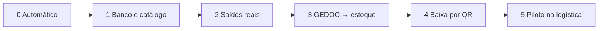

# Plano de testes

Este plano diz **o que testar, em que ordem e quando o sistema está pronto para o uso diário** da logística. Cada fase só começa quando a anterior passou. Quem executa marca as caixas e anota data e nome no fim do arquivo.



## Fase 0 — Testes automáticos (sem banco)

Rodam no computador de quem programa, antes de qualquer pull request.

```bash
npm run lint
npm run typecheck
npm test
```

| O que cobre | Onde |
|---|---|
| Família, categoria, marca e atributos lidos da descrição do catálogo legado | `backend/tests/regras.test.ts` |
| Validação do documento enviado pelo GEDOC (protocolo, tipo, itens, quantidades) | `backend/tests/regras.test.ts` |
| Regras da baixa: soma exata, item em dois locais, falta de saldo, retirada fora do documento | `backend/tests/regras.test.ts` |
| Montagem e envio do documento do GEDOC para o estoque | `gedoc/tests/documentos/estoque-sync.test.ts` (`npx vitest run tests/documentos`) |

- [ ] Lint, typecheck e `npm test` sem erros no estoque
- [ ] `npx vitest run tests/documentos tests/security/03-documentos-authz.test.ts` sem erros no GEDOC

## Fase 1 — Banco e catálogo real (Supabase de desenvolvimento)

Responsável: frente de banco de dados. **Nunca na primeira vez em produção.**

1. Aplicar `backend/supabase/migrations/20261030090000_schema_estoque.sql` e expor o schema `estoque` (Project Settings > API > Exposed schemas). No projeto principal da empresa, **faça backup antes**: a migração só cria o schema `estoque` e não mexe em `public`.
2. Gerar o catálogo: `npm run catalogo:gerar -- "D:/sistemaDocumentos/gedoc/produtos.db"` e conferir `backend/supabase/catalogo-real/RESUMO.txt`.
3. Aplicar `000-estrutura.sql` e depois cada `NNN-variantes.sql`, na ordem, no editor SQL.

- [ ] A contagem de `variantes` é igual ao "Variantes" do `RESUMO.txt` (hoje 3905)
- [ ] Reaplicar um lote não duplica nada (rodar `001-variantes.sql` duas vezes e contar de novo)
- [ ] `select count(*) from variantes where marca is null` bate com "Sem marca" do resumo
- [ ] Nenhuma variante ficou fora: `select count(*) from variantes v left join familias f on f.id = v.familia_id where f.id is null` dá 0
- [ ] Revisar a categoria "Diversos" (cerca de 6% do catálogo) e reclassificar o que for relevante em `/catalogo`
- [ ] Rever a tabela "O que o banco precisa recusar" de [[banco-de-dados]]; incluir: marca só com espaços e `tipo_documento` fora de `ORCAMENTO`, `AMOSTRA`, `PRODUCAO` são recusados

## Fase 2 — Saldos reais

O catálogo não traz quantidades: elas nascem de **entradas**, nunca do seed. Cadastre os locais reais (`/locais`) e lance a contagem inicial.

- [ ] Locais reais cadastrados (galpão, setores, módulos) com códigos de etiqueta
- [ ] Contagem física lançada como entrada em `/movimentacoes/nova`, local por local (para volume grande, usar a importação da Etapa 9 quando existir)
- [ ] Amostra de 20 itens conferida na prateleira: saldo do sistema igual ao físico
- [ ] `/consulta` abre em menos de 3 s no celular com o catálogo inteiro, filtrando por família e marca

## Fase 3 — GEDOC → estoque

Pré-requisitos: `GEDOC_INTEGRATION_TOKEN` igual nos dois `.env.local` (mínimo 24 caracteres), `ESTOQUE_APP_URL` no GEDOC apontando para o estoque.

Teste direto na rota (troque a URL e o token):

```bash
curl -i -X POST "$ESTOQUE_APP_URL/api/documentos" \
  -H "Authorization: Bearer $GEDOC_INTEGRATION_TOKEN" \
  -H "Content-Type: application/json" \
  -d '{"protocolo":"ORC-20261029-TS01","tipo_documento":"ORCAMENTO","cliente_nome":"Teste","solicitante_nome":"Teste","validado":false,"itens":[{"codigo":"50501","quantidade":2}]}'
```

| Cenário | Esperado |
|---|---|
| Sem cabeçalho ou token errado | 401 |
| Token não configurado no servidor | 503 |
| Documento válido novo | 201, aparece em `/documentos` como "aguardando" |
| Mesmo protocolo reenviado com `validado: true` | 200, passa a "validado" |
| Código inexistente | 422 com a lista dos códigos, nada gravado |
| Protocolo malformado, quantidade 0 ou item sem código | 400 |
| Reenviar um documento já baixado | 409 |

- [ ] Todos os cenários da tabela
- [ ] No GEDOC: validar um orçamento real em `/gestao/validacao` e ver o documento chegar em `/documentos` do estoque como validado
- [ ] Parar o estoque e validar outro orçamento no GEDOC: a validação conclui e a tela avisa que o estoque não recebeu

## Fase 4 — Baixa por QR code

Use um celular real. Escaneie o QR do PDF (ou abra `/leitura/<protocolo>`).

| Cenário | Esperado |
|---|---|
| Documento não validado | Aviso "Aguardando validação no GEDOC"; botão de baixa desabilitado |
| Item com saldo em dois locais | Sugestão junta os dois locais; pode sair de ambos na mesma baixa |
| Soma retirada diferente do pedido | Botão desabilitado; o backend também recusa |
| Falta saldo em um item | Alerta com a quantidade que falta; nada é baixado |
| Confirmar a baixa | Saldos descem, movimentações de saída ligadas ao documento, documento vira "baixado" com quem e quando |
| Confirmar de novo (ou duas pessoas ao mesmo tempo) | Uma só baixa; a outra recebe "já foi baixado" |
| Estoquista abre o documento | Vê os itens, não vê o botão de confirmar |
| Perfil `pendente` ou sem login | Vai para o login; não recebe dados |

- [ ] Todos os cenários, no celular (360 px) e no computador
- [ ] Conferir em `/movimentacoes` o histórico com o autor correto
- [ ] Marcar a Definition of Done de [[etapa-8-documentos]]

### Leitura pela câmera (celular)

A câmera do celular **tem que estar em https**: em `http` o navegador bloqueia o acesso à câmera (só `localhost` é exceção).

| Cenário | Esperado |
|---|---|
| Câmera nativa do celular lê o QR do PDF, sem estar logado | Abre o login; depois de entrar, volta direto ao documento (`/leitura/<protocolo>`) |
| Mesmo QR, já logado | Abre o documento |
| `/leitura` → "Abrir câmera" → apontar para o QR | Abre o documento sozinho; a câmera desliga |
| QR de outra coisa (outro site, código de barras) | Aviso "não é de um documento do GEDOC"; não navega |
| Negar a permissão da câmera | Mensagem explicando como liberar; campo de protocolo continua funcionando |
| Digitar o protocolo na tela `/leitura` | Abre o documento; protocolo inválido mostra erro |
| QR de orçamento ainda não validado | Abre o documento com "Aguardando validação no GEDOC" e baixa bloqueada |
| Validar o orçamento no GEDOC e recarregar a página | Passa a "validado" e libera a baixa |
| Voltar o orçamento para pendente no GEDOC | Bloqueia a baixa de novo (se ainda não foi baixado) |

- [ ] Todos os cenários em pelo menos um Android e um iPhone (o iPhone usa a leitura por `jsqr`)

### Inventário

| Cenário | Esperado |
|---|---|
| Abrir inventário de um local com saldo | Lista os itens com o saldo do momento |
| Abrir um segundo inventário do mesmo local | Recusado: "já existe um inventário aberto" |
| Contar um item e sair do campo | Grava e mostra o "ok"; o contador de itens contados sobe |
| Limpar o campo de um item contado | A contagem some e o item volta a "não contado" |
| Incluir item encontrado fora da lista | Entra com saldo do sistema 0 e a quantidade contada |
| Resumo com itens não contados | Aviso de que ficam como estão |
| Alguém dá baixa no local depois da abertura | O resumo compara com o saldo de agora, não com o da abertura |
| Concluir | Saldos ajustados, um ajuste por diferença no histórico (`Ajuste de inventário`), inventário concluído |
| Concluir de novo ou alterar depois de concluído | Recusado |
| Cancelar | Nenhum saldo muda; não reabre |
| Estoquista abre as telas | Vê, mas não vê botões de contar, concluir ou cancelar |

- [ ] Todos os cenários

## Fase 5 — Piloto na logística

Duração sugerida: uma semana, com um turno e um gerente de estoque.

- [ ] Todo documento validado no GEDOC naquela semana foi baixado pelo QR code
- [ ] Diferença entre saldo do sistema e prateleira conferida em 3 dias diferentes (inventário por local, Etapa 7)
- [ ] Lista dos problemas do piloto registrada e priorizada
- [ ] Gerente de estoque confirma que o uso é mais rápido que o processo anterior

## Pronto para o uso diário quando

1. Fases 0 a 4 inteiras marcadas.
2. Backup do banco feito antes da carga de saldos.
3. `GEDOC_INTEGRATION_TOKEN` e `SUPABASE_SECRET_KEY` só nos servidores, nunca no repositório.
4. Pelo menos duas pessoas com perfil de operação (gerente de estoque ou admin).

## Registro

| Fase | Data | Quem | Resultado |
|---|---|---|---|
| 0 | | | |
| 1 | | | |
| 2 | | | |
| 3 | | | |
| 4 | | | |
| 5 | | | |

## Ligações
[[roteiro]] · [[etapa-8-documentos]] · [[banco-de-dados]] · [[backend]]
